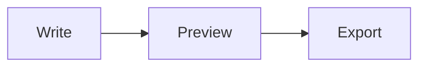

# Welcome to RuneQi

RuneQi is a Markdown editor that runs entirely in your browser. Write on the left and watch the preview on the right update as you type.

Your files are saved automatically in this browser: no account, no server. To keep a copy somewhere else, export it from **Menu → Import/Export**.

## Getting started

- [x] Open RuneQi
- [ ] Edit this file, or create your own from the file explorer (folder icon, top left)
- [ ] Format text with the toolbar, or with **Ctrl + Shift** + a key (**Cmd + Shift** on macOS)
- [ ] Paste or drop an image into the editor
- [ ] Open the menu (**•••**, top right) to change the theme, the font or the layout

## The basics

**Bold**, *italic*, ~~strikethrough~~ and `inline code`. Links look like [this](https://runeqimd.dev).

> Blockquotes are handy for notes and quotes.

1. Lists continue on their own when you press Enter
2. Press Enter on an empty item to leave the list
   - Lists can also be nested

## Tables

| Shortcut | Action |
|---|---|
| Ctrl + Shift + B | Bold |
| Ctrl + Shift + I | Italic |
| Ctrl + Shift + L | Link |
| Ctrl + Shift + M | Table |

See them all in **Menu → Keyboard Shortcuts**.

## Code

Write the language after the opening backticks to get syntax highlighting:

```js
function greet(name) {
    return `Hello, ${name}!`;
}
```

## Math

Inline formulas like $E = mc^2$, or a block of their own:

$$
\int_0^1 x^2 \, dx = \frac{1}{3}
$$

## Diagrams

Code blocks in `mermaid` are drawn as diagrams:



## Images

Paste or drop an image into the editor: RuneQi saves it in the **Images** folder and writes the Markdown for you, like ``.

## Your files

- Organize your files in folders from the file explorer
- Deleted files go to **Trash** first, so you can still get them back
- Import `.md` files, or export the open one, from **Menu → Import/Export**

---

Happy writing! ✍️
